  
   
  <a href="https://hope2rest.github.io/hope2rest/game/space/">▶ 은하 전투기 직접 해 보기</a>
  &nbsp;·&nbsp;
  <a href="https://hope2rest.github.io/hope2rest/game/">이전 버전: 강아지 달리기</a>

## AI(AX) 교육 사업 발굴/기획/제안/운영, AI 커리큘럼 개발

- 정부 AI(AX) 교육 사업 발굴·기획·제안·운영 전 과정 담당
- AI·AX 기반 커리큘럼 개발, AI·IT 교육 과정 기획·운영·관리
- 프론트엔드 개발·서비스 기획 경험 기반 Claude·GPT 멀티 에이전트 구축, 제안 업무 활용
